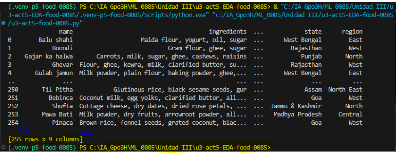
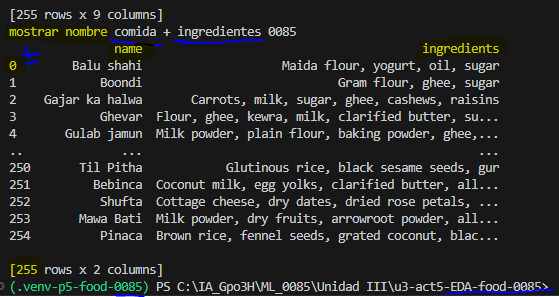
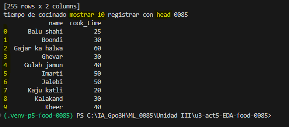

## añisis exploratorio
## comida del pais india
## ricardo lopex NC 0085
## -+-+ importar datos del archivo csv de comida de india+-+-

## -+-+ mostrar nombre comida + ingrediente

## tiempo de cocinado mostrar 10 registrar con head 0085
